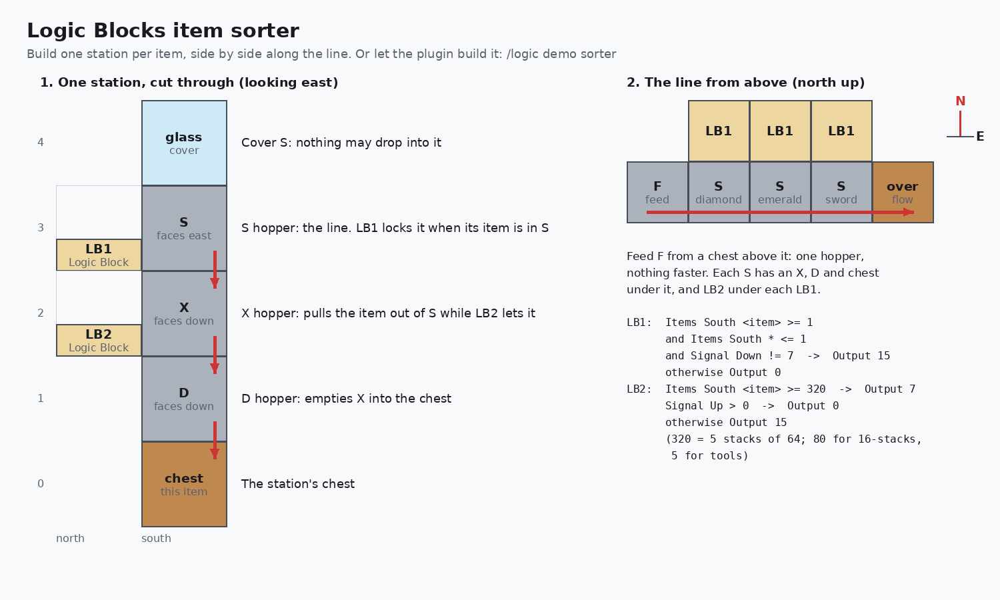

# Build: item sorter

A hopper line that drops each chosen item into its own chest and passes everything else on. Each station is one
block wide and uses two Logic Blocks: no comparators, no filler items, no signal strengths to tune. Unlike a vanilla
sorter it sorts **unstackable items too** (tools, armour, potions, shulker boxes) and **jams nothing when a chest is
full**: that station's items carry on to the overflow.

Tested on a real Paper 26.3 server by the self-test (`paper-selftest`, "sorter" steps): 60 mixed items and 190
mixed items sorted with no wrong items and nothing stuck, at 2.4 items per second (a hopper's top speed is 2.5).

## Try it first

As an operator, stand somewhere open and run:

```
/logic demo sorter                                  (diamond, emerald, diamond_sword)
/logic demo sorter iron_ingot gold_ingot redstone   (any 1 to 8 items)
```

It builds a working sorter next to you (starting 1 block east and 2 south of your feet; it needs a clear space
the length of the line, 2 wide and 5 high), with the Logic Blocks programmed and owned by you and the feeder chest
stocked with a mix. Watch it sort, then open the Logic Blocks to see their rules, or break it down to see the
layers. It's the same build the self-test checks on a real server.



## One station

The line runs east here, with the Logic Blocks on its north side. Looking along the line:

```
             north       south
 layer +4                [ any solid block ]   cover the line hopper (hoppers suck up items dropped on them)
 layer +3    [ LB1 ]     [ S: hopper, facing east ]   the line: passes items to the next station
 layer +2    [ LB2 ]     [ X: hopper, facing down ]   takes this station's item out of S
 layer +1                [ D: hopper, facing down ]   drains X into the chest
 layer  0                [ chest ]
```

LB1 touches only S (and LB2). LB2 touches only X (and LB1). Stations sit side by side along the line, one per block.

**LB1** (reads the line hopper S, to its south):

| Rule | Conditions | Then |
|---|---|---|
| 1 | **Items** South `diamond` `>=` 1, **Items** South `*` `<=` 1, **Signal** Down `!=` 7 | **Output** 15 |
| Otherwise | | **Output** 0 |

**LB2** (reads X, to its south, and LB1 above it):

| Rule | Conditions | Then |
|---|---|---|
| 1 | **Items** South `diamond` `>=` 320 | **Output** 7 |
| 2 | **Signal** Up `>` 0 | **Output** 0 |
| Otherwise | | **Output** 15 |

Change `diamond` to the station's item. The 320 in LB2 is "X is full": 5 stacks, so 320 for items that stack to 64,
80 for 16 (eggs, ender pearls), and 5 for items that don't stack (tools, potions).

## How it works

- **The item arrives in S, alone.** LB1 turns on: S is locked, so it stops passing items along. LB2 sees LB1 on
  and turns off: X unlocks and pulls the item down; D moves it into the chest. S is empty again, LB1 turns off,
  LB2 locks X.
- **Anything else arrives.** LB1 stays off, S passes it to the next station, X stays locked.
- **Why "`*` <= 1".** A hopper below always pulls the first item in S. If two items are in S at once, the station
  waits until its item is alone, so it never takes the wrong one.
- **Why D.** A locked hopper can't push, but it can still be emptied from below. Without D, the last item of each
  run would wait in X until the next one arrived.
- **Full chest.** When the chest and D are full, X fills up. LB2 then says "full" with strength 7, LB1 stops
  taking its item, and it flows on to the overflow. When you empty the chest, the station starts taking items again.

## Building it

1. **Feed the line through one hopper.** Items must enter the first station no faster than one hopper delivers
   them. Several hoppers, a minecart, or a chest directly above a line hopper can push items in faster; then the
   Logic Blocks (which react within 2-4 ticks) can be too slow and a wrong item can slip through (the self-test
   measured one wrong item in 68, and 41% of the station's items going past, at double speed).
2. **Cover every line hopper** with a solid block, so dropped items and chests above can't add to it.
3. **End the line in an overflow chest** (or more hoppers to more chests). Everything that isn't sorted, and
   everything for a full station, goes there.
4. **Several items per station:** give LB1 one rule per item (same three conditions with a different id) and LB2 one
   "full" rule per item, above its "Signal Up" rule.
5. **Orientation:** with the line running another way, keep LB1 and LB2 beside S and X on the same side and set
   "South" in the rules to the side they actually face. Look at a Logic Block with the mod to see its N, E, S, W.

## Limits

- **Item ids only.** It can't tell enchanted books, potions or tipped arrows apart by their contents: they share an
  id.
- **One hopper's speed** (2.5 items per second). For more, run several lines side by side.
- **The overflow can fill.** When it does, the line backs up, as with any sorter.
